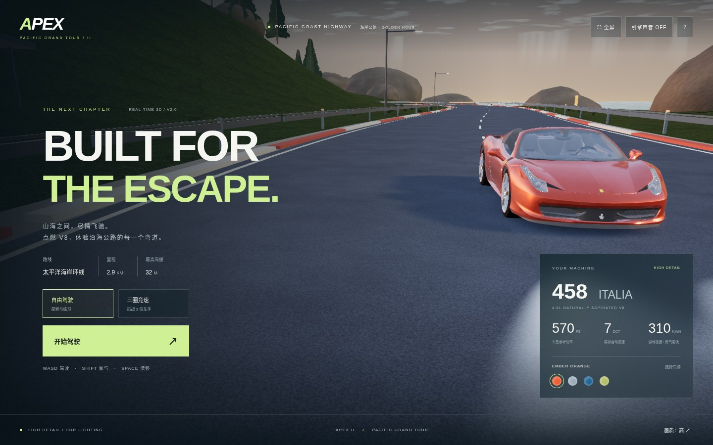
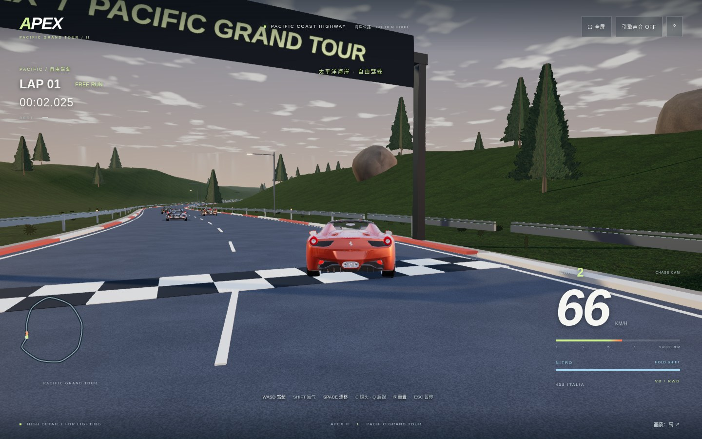

# APEX II / 极境飞驰

电脑浏览器 3D 赛车游戏，第二版升级了车辆模型、地形和驾驶反馈。



## 直接下载游玩

**[下载赛车游戏 ZIP](https://github.com/luoyonggang/ha/raw/refs/heads/main/downloads/APEX-Racing.zip)**

解压后，用电脑 **Chrome 或 Edge** 打开 `APEX赛车.html`，点击“开始驾驶”。无须安装 Node.js，资源全部内置，可以断网游玩。高画质建议独立显卡与浏览器硬件加速；卡顿可切换右下角「流畅」画质。

可选择自由驾驶或三圈竞速。支持换车漆、开启引擎声音与全屏。

| 按键 | 功能 |
| --- | --- |
| W / ↑ | 油门 |
| S / ↓ | 刹车、停稳后倒车 |
| A D / ← → | 转向 |
| 空格 | 手刹漂移 |
| Shift | 氮气加速；松开自动补充 |
| C | 追车 / 车内 / 引擎盖 / 高位镜头 |
| Q | 按住后视 |
| R | 重置本次驾驶 |
| Esc | 暂停，点击“继续驾驶”恢复 |

## 第二版内容

- 458 Italia 精细赛车模型，约 36 万三角面，包含内饰、轮胎、轮毂、独立转向和车轮转动。
- HDR 环境反射、金属车漆、车窗、阴影、接触阴影、灯光辉光与抗锯齿。
- 约 2.9 公里起伏海岸环线、岩石地形、针叶植被、路面纹理、护栏与道路设施。
- 街机驾驶模拟：速度相关转向、轮胎侧滑、悬挂姿态、刹车灯、胎烟、轮胎痕迹、氮气尾焰及动态引擎声。
- 三位循迹 AI 车手、三圈竞速、计时与名次结果；本地保留最佳圈速。
- 玩家保留精细模型，其他车辆使用简化模型；环境设施采用批量实例渲染。

这是独立浏览器赛车游戏。画质与体验已提升，但不是《极品飞车》的复刻，也不承诺达到商业大作的某个百分比。驾驶和碰撞为简化街机模拟，AI 沿固定赛道路线行驶。



## 源码开发

Node.js 20.19+ 或 22.12+（当前环境使用 Node 24）。

```sh
npm ci --cache /workspace/.npm-cache
npm run dev
```

开发服务器默认端口 5173。`npm run build` 生成生产资源；`npm run preview` 检查生产构建。

```sh
npm test                 # 5 项驾驶物理测试
npm run package:game     # 构建并生成单文件 HTML 与 ZIP
npm run test:browser     # 浏览器驾驶、竞速结算和离线包测试
```

浏览器测试使用 Playwright。在没有 Chromium 的机器上先执行 `npx playwright install chromium`。可以通过 `APEX_CHROMIUM_PATH` 指定浏览器位置。云环境测试使用 `/usr/bin/chromium` 的软件渲染，不能据此推断用户电脑的帧率。

游戏不需要后端或密钥。第三方资产来源与授权见 [THIRD_PARTY_NOTICES.md](THIRD_PARTY_NOTICES.md)。
